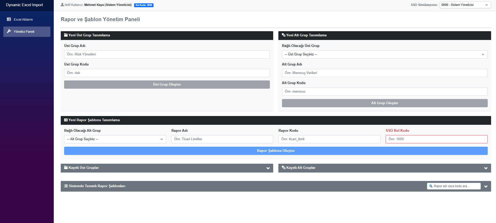
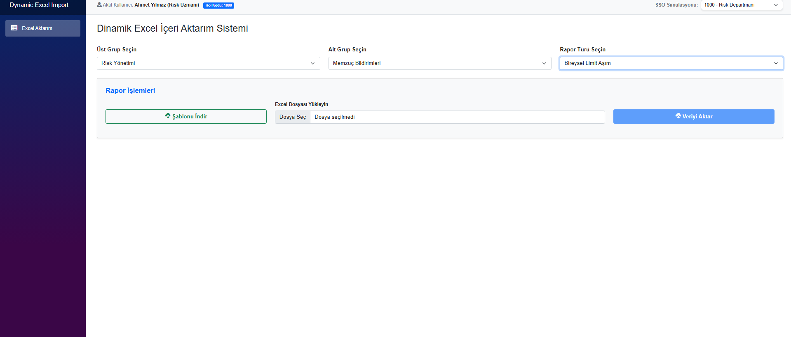

# 📊 Merkezi Rapor Verisi Aktarım Sistemi

## 📌 Genel Bakış
Bu proje, veri yönetimi ve iş zekası süreçlerindeki manuel rapor aktarım operasyonlarını otomatize etmek amacıyla geliştirilmiş tam kapsamlı bir **Dinamik Veri Aktarım** platformudur. 

Sistem, geleneksel "hard-coded" (koda gömülü) yazılım geliştirme pratiklerinin aksine, aktarılacak Excel verilerinin şemasını ve kurallarını SQL veritabanındaki metadata (üst veri) tablolarından okuyarak dinamik bir yapı sunar. Bu sayede yeni bir rapor şablonu eklendiğinde kod tarafında bir güncelleme yapılmasına gerek kalmaz.

## ✨ Özellikler
- 🚀 **Dinamik Excel Parsing:** Sütun adları, uzunluk ve tip kontrollerinin veritabanından dinamik okunması.
- 🗄️ **Metadata Yönlendirmeli Mimari:** `ImportReportField` tabloları üzerinden kural ve validasyon (doğrulama) yönetimi.
- ⚡ **Katmanlı Yapı:** Backend (API) ve Frontend (UI) olarak ayrıştırılmış, sürdürülebilir N-Tier mimarisi.
- 🛡️ **Güvenli Aktarım:** Hatalı verilerin ayıklanması ve başarılı verilerin hedefe kayıpsız iletilmesi.
- 🔐 **Rol Bazlı Erişim (SSO Simülasyonu):** Kullanıcı yetkilerine göre dinamik ekran ve modül yönetimi.

## 🧠 Mimari Akış (Pipeline)

```text
Kullanıcı Rapor Yüklemesi (Excel)
        │
        ▼
UI Katmanı (Dosya İletimi)
        │
        ▼
RESTful API (Parsing & Validation)
        │
        ▼
SQL Metadata Kontrolü (Sütun Kuralları Eşleşmesi)
        │
        ▼
Hedef Veritabanına Aktarım
```

## 🛠 Kullanılan Teknolojiler

| Kategori | Teknoloji | Görevi |
| :--- | :--- | :--- |
| **Programlama Dili** | C# | Sistem temel iş mantığı |
| **Backend Katmanı** | .NET Core Web API | Excel ayrıştırma ve veri işleme |
| **Frontend Katmanı** | .NET UI | Kullanıcı arayüzü ve dosya yükleme |
| **Veritabanı** | MS SQL Server | Metadata ve yapılandırma yönetimi |

## 📂 Proje Yapısı

```text
merkezi-rapor-sistemi/
│
├── DynamicExcelImport.API/     # Arka uç iş mantığı ve RESTful uç noktalar
├── DynamicExcelImport.UI/      # Kullanıcı arayüzü katmanı
├── SQL/
│   └── TabloGucelleme.sql      # Sistemin altyapısını kuran metadata tabloları
├── Screenshots/                # Proje arayüzüne ait görseller
└── README.md                   # Proje dokümantasyonu
```

## 📷 Ekran Görüntüleri ve Rol Yönetimi

Sistem, kullanıcıların yetki seviyelerine göre farklı arayüzler sunar:

### 1. Yönetici Paneli (Rol: Sistem Yöneticisi)
Sistem yöneticileri, sisteme yeni rapor şablonları, üst gruplar ve alt gruplar tanımlayarak sistemin dinamik altyapısını yönetir.


### 2. Excel Aktarım Paneli (Rol: Risk Uzmanı vb.)
Standart kullanıcılar, sadece kendi departmanlarına ve rollerine tanımlanmış rapor türlerini seçerek Excel aktarımı yapabilir ve ilgili formata uygun şablonu indirebilir.


## ▶️ Kurulum ve Çalıştırma

Projeyi bilgisayarınıza klonlayın:
```bash
git clone https://github.com/kullanici-adiniz/merkezi-rapor-sistemi.git
cd merkezi-rapor-sistemi
```

SQL Server üzerinde veritabanını hazırlayın:
> `SQL` klasörü içindeki `TabloGucelleme.sql` scriptini çalıştırarak mimarinin ihtiyaç duyduğu `ImportUpperGroup`, `ImportReport` ve `ImportReportField` tablolarını oluşturun.

API katmanını çalıştırın:
```bash
cd DynamicExcelImport.API
dotnet run
```

## 🔑 Ortam Değişkenleri (Veritabanı Bağlantısı)

Projeyi çalıştırmadan önce `DynamicExcelImport.API` içerisindeki `appsettings.json` dosyasında bulunan SQL bağlantı cümlesini (Connection String) kendi lokal veritabanı ayarlarınıza göre güncellemeniz gerekmektedir:
```json
"ConnectionStrings": {
  "DefaultConnection": "Server=localhost;Database=RaporDB;Trusted_Connection=True;"
}
```

## ⚠️ Sınırlamalar ve Kurumsal Gizlilik
*Bu depo, Albaraka Tech Teknopark veri yönetimi staj süreci kapsamında geliştirilen mimarinin çekirdek yapısını barındırmaktadır. Kurumsal veri gizliliği politikaları gereği, kuruma ait spesifik rapor scriptleri (memzuc, bilanço, sso iş akışları) ve gerçek veriler projeden arındırılmış, sistem tamamen mock (sentetik) konfigürasyonlarla sergilenmiştir.*

## 👨‍💻 Geliştirici
**Şerife Gizem Kayacan**  
*Bilgisayar Mühendisliği Öğrencisi | Düzce Üniversitesi*  
[LinkedIn Profilim](https://www.linkedin.com/in/gizem-kayacan)
